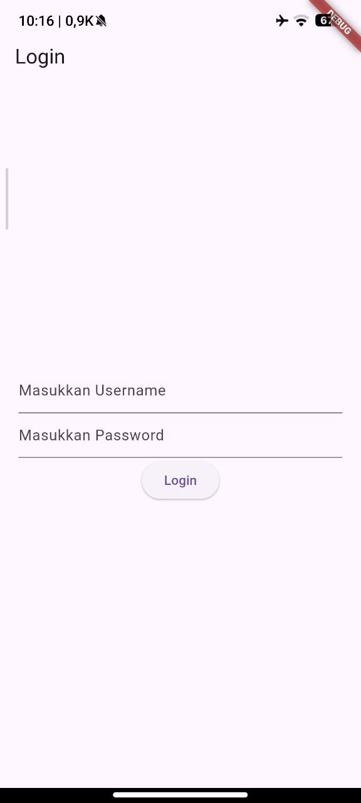
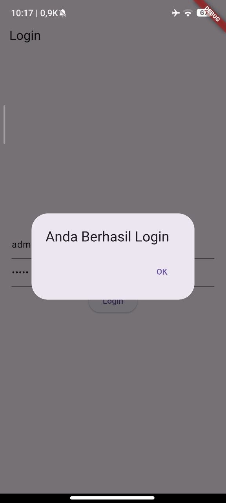
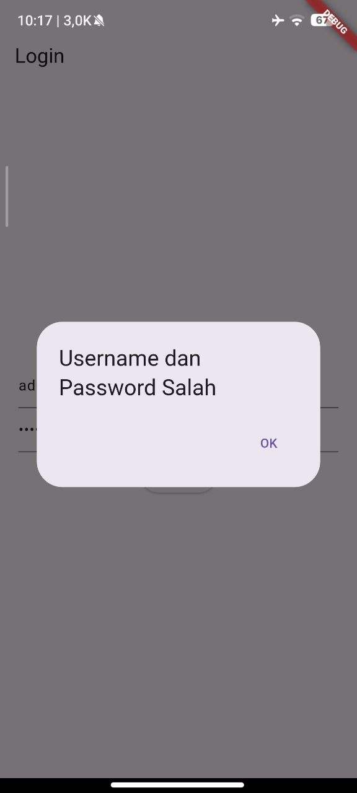
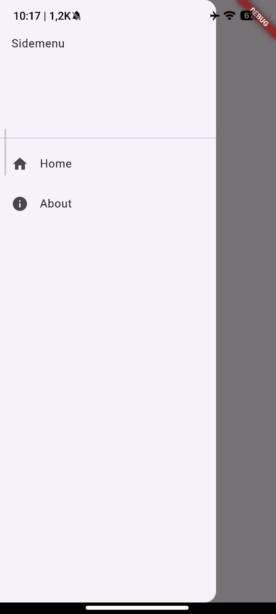

# Modul 3 — Routes, Side Menu, Login dan Local Storage Framework Flutter

| Informasi | Detail                   |
|-----------|--------------------------|
| Nama      | Muhammad Faqih Muhyiddin |
| NIM       | H1D024068                |
| Shift     | D (KRS: E)               |

Tugas Praktikum Pemrograman Mobile: membuat aplikasi Flutter (`router_flutter`) yang mengimplementasikan sistem autentikasi login, penyimpanan sesi lokal (`shared_preferences`), navigasi rute halaman, dan menu navigasi samping (Drawer) sesuai Modul 3.

## Screenshot

| Halaman Login | Dialog Berhasil Login | Dialog Gagal Login |
|---|---|---|
|  |  |  |

| Home Page | Side Menu (Drawer) | About Page |
|---|---|---|
|  |  |  |

## Yang Dikerjakan

| Bagian modul | File | Isi |
|---|---|---|
| 2.b. Dependencies | `pubspec.yaml` | Menambahkan package `shared_preferences` untuk penyimpanan data lokal pengguna |
| 2.c. Login Page | `lib/login_page.dart` | Form login (username & password), validasi login `admin`/`admin`, popup dialog alert, dan penyimpanan username ke local storage |
| 2.c. Entry Point | `lib/main.dart` | `MyApp` mengarahkan rute awal (`home`) ke `LoginPage()` |
| 2.d. Home Page | `lib/home_page.dart` | Mengambil dan menampilkan data username dari `SharedPreferences` serta memuat Drawer `Sidemenu` |
| 2.e. Side Menu | `lib/sidemenu.dart` | Komponen Drawer yang berisi navigasi menu ke `HomePage` dan `AboutPage` |
| 2.e. About Page | `lib/about_page.dart` | Halaman About yang berisi informasi halaman dan Drawer `Sidemenu` |

## Penjelasan

- **SharedPreferences**: Digunakan untuk menyimpan data secara persisten di local storage perangkat berbasis key-value. Dalam modul ini, username disimpan saat login berhasil menggunakan `prefs.setString('username', ...)` dan dibaca kembali di HomePage menggunakan `prefs.getString('username')`.
- **Navigator & MaterialPageRoute**: Digunakan untuk navigasi dan perpindahan antar layar (rute). `Navigator.push()` menumpuk halaman baru ke atas stack navigasi, sedangkan `Navigator.pushReplacement()` menggantikan halaman aktif saat ini.
- **AlertDialog**: Menampilkan popup dialog konfirmasi setelah proses login ditekan (baik berhasil maupun gagal) sebelum berpindah ke halaman tujuan.
- **Drawer & ListTile**: Menyediakan panel navigasi samping (*side menu*) yang dapat dibuka lewat tombol hamburger pada AppBar atau dengan menggeser layar dari tepi kiri. Tiap item menu menggunakan `ListTile` dengan event `onTap`.
- **StatefulWidget & initState**: Digunakan pada `LoginPage` (mengelola controller input) dan `HomePage` (memuat data username secara asinkron dari SharedPreferences begitu halaman pertama kali dibuat via `initState()`).
- **TextEditingController**: Menyimpan dan membaca input teks yang diketikkan pengguna pada `TextField` username dan password, serta dibersihkan menggunakan method `dispose()`.

### Penyesuaian dari kode modul

| Di modul | Di proyek ini | Alasan |
|---|---|---|
| `const MyApp({Key? key}) : super(key: key);` | `const MyApp({super.key});` | Standar penulisan constructor singkat Flutter modern |
| `_LoginPageState createState()` | `State<LoginPage> createState()` | Mengikuti konvensi Flutter linter agar tipe kembalian tidak berupa private class |
| `var namauser;` | `String namauser = '';` | Tipe data didefinisikan secara eksplisit dan aman dari null/uninitialized |
| `_loadUsername()` dipanggil di dalam `build()` | Dipanggil di dalam `initState()` | Menghindari infinite build loop akibat `setState()` yang terpanggil terus-menerus di method `build()` |
| Dialog tidak di-`pop()` saat navigasi | `Navigator.of(dialogContext).pop()` sebelum navigasi | Memastikan dialog tertutup bersih dan tidak tertinggal di navigation stack |
| Controller tidak di-`dispose` | Ditambahkan `dispose()` | Mencegah kebocoran memori (*memory leak*) pada aplikasi |
| Navigasi sidemenu menumpuk halaman | `Navigator.pushReplacement(...)` | Mencegah penumpukan stack halaman berulang kali saat berpindah antara Home dan About |

## Struktur Folder

```
lib/
├── main.dart        Entry point (MyApp), home: LoginPage
├── login_page.dart  Halaman Login & autentikasi SharedPreferences
├── home_page.dart   Halaman utama (menampilkan user & drawer)
├── about_page.dart  Halaman About (menampilkan info & drawer)
└── sidemenu.dart    Komponen Drawer menu navigasi
screenshots/         Tangkapan layar hasil implementasi aplikasi
```

## Cara Menjalankan

```bash
flutter pub get
flutter run
```

Pilih perangkat (HP Android fisik dengan USB/Wireless debugging, emulator, atau Windows desktop/Edge) saat diminta.

Akun default login:
- **Username:** `admin`
- **Password:** `admin`
